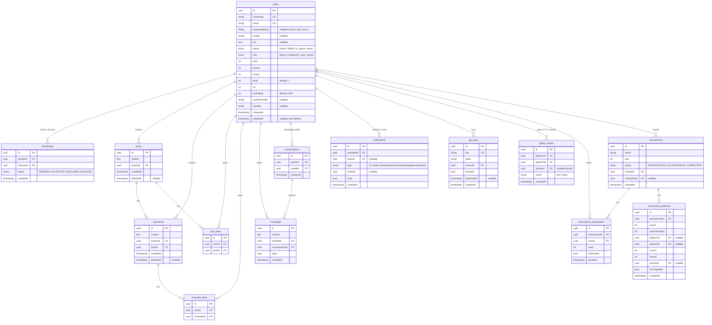

*This project has been created as part of the 42 curriculum by aghalmi, amoderan, smadani and mhammoud.*

# ft_transcendence

## Description

**ft_transcendence** is a full-stack, real-time web platform built around online
gaming and a social layer. Registered users can play a server-authoritative
**Tic-Tac-Toe** game against each other over the network, take part in
automatically-seeded **elimination tournaments**, follow an activity feed, chat
privately, manage a friends list with live presence, track their ELO / level /
match history, and exercise their GDPR rights (data export and account deletion).

The whole stack is containerised and starts with a single command. Every request
that reaches the backend from a browser goes through an HTTPS reverse proxy.

### Key features

- Email / password authentication (bcrypt-hashed) with JWT sessions.
- Real-time **Tic-Tac-Toe** with a server-side rules engine, live game state
  broadcast over WebSockets, graceful opponent-disconnect handling, ELO update
  and persisted match results.
- **Tournament system**: registration, random seeding, automatic bracket
  generation, round-by-round progression and a crowned champion.
- Social layer: posts, comments, likes, a private 1-to-1 chat, a friends system
  with request / accept / remove, and **live online/offline presence**.
- A **notification system** covering creation, update and deletion events
  across friends, posts, comments, messages and tournaments.
- A secured **public REST API** (`/api/v1`) authenticated by API key, rate
  limited, and documented with Swagger.
- **User management**: editable profile, avatar upload, role-based admin area,
  leaderboard, match history.
- **DevOps**: `/health` endpoint, service status page, scheduled database
  backups and a documented disaster-recovery procedure.
- **GDPR centre**: one-click data export and account deletion with email
  confirmation.
- Additional, self-contained single-player arcade prototypes (Pong RPG,
  ShooTacToe, Snake CTF) built on the same design system.

---

## Team Information

| Member | 42 login | Role(s) | Responsibilities |
|---|---|---|---|
| Alex Moderan | `amoderan` | **Technical Lead / Architect** · Backend Developer | Overall backend architecture, database schema and relations, technology-stack decisions, authentication foundation, WebSocket layer, tournaments / matches / API-keys / public-API / mailer / GDPR / health modules, code review of critical changes. |
| Amir Ghalmi | `aghalmi` | **Project Manager / Scrum Master** · Backend & Frontend Developer | Repository ownership, branching strategy, pull-request review and merge coordination, milestone and deadline tracking. Owns the social vertical end-to-end: backend (posts, comments, likes, notifications, private chat, global search) **and** its frontend (feed, chat UI, notification centre). |
| Sana Madani | `smadani` | **Product Owner** · **Lead Frontend Developer** | Product vision, feature prioritisation and UX decisions. Owns the app shell and design system: reusable UI kit, routing and context architecture, authentication screens, legal pages, profile / leaderboard / admin UI, and the Tic-Tac-Toe lobby & arena UI (gaming-hub integration, game-sharing flow). |
| Moaad Hammouda | `mhammoud` | Developer (Backend & Frontend) | Tic-Tac-Toe game engine: the rules class (win / draw detection, turn validation, move legality), the initial games module wiring, **and** its frontend board component — plus the arcade prototype front-ends. |

> With a four-person team, members hold multiple roles: dedicated PO, PM and Tech
> Lead responsibilities are covered, and every member also contributes as a
> developer.

---

## Project Management

- **Work organisation.** The project was split along a clear front / back seam.
  The Tech Lead defined the module boundaries up front; each module (auth, posts,
  chat, games, tournaments, …) was owned end-to-end by one developer, with the
  entities and their relations agreed as a team before implementation started.
  Work was tracked as a backlog of module-sized tasks, re-prioritised at each
  sync.
- **Tools.** GitHub for source hosting, **GitHub Issues / Projects** for the task
  board, and **pull requests** for every change — no direct pushes to `main`,
  each PR reviewed by at least one other member (typically the Tech Lead for
  backend, the PO for frontend).
- **Communication.** A team **Discord** server for daily async updates and quick
  questions, plus two weekly in-person syncs at 42 to review progress, unblock,
  and re-plan.
- **Branching.** `feature/*` branches per task → PR → `main`. Larger efforts
  (the frontend rework, the game-logic integration) went through dedicated
  `merge/*` integration branches.

---

## Technical Stack

### Frontend

| Concern | Choice |
|---|---|
| Framework | **React 19** (function components + hooks) |
| Build tool | **Vite 8** (dev server with API/WebSocket proxy, production bundle) |
| Language | **TypeScript** (strict build via `tsc -b` before bundling) |
| Styling | **Tailwind CSS** with a custom dark "cyber" theme (extended palette, Inter typeface) |
| Real-time | Native `WebSocket` client speaking the Socket.IO wire protocol |
| State | React Context (`AuthContext`, `ChatContext`, `GameContext`, `NotificationContext`) |

### Backend

| Concern | Choice |
|---|---|
| Framework | **NestJS 11** (modular architecture, dependency injection, guards, pipes) |
| Language | **TypeScript** |
| ORM | **TypeORM 0.3** with explicit SQL migrations (no `synchronize` in any environment) |
| Auth | `@nestjs/jwt` + `passport-jwt`; passwords hashed with **bcrypt**; a 42 intra OAuth 2.0 authorization-code flow was built but is no longer exposed in the UI (see Known Limitations) |
| Real-time | `@nestjs/websockets` + `socket.io` (namespaced gateways: `/games`, `/chat`) |
| Validation | `class-validator` / `class-transformer` through a global `ValidationPipe` (`whitelist`, `forbidNonWhitelisted`, `transform`) |
| Rate limiting | `@nestjs/throttler` (global limit + a tighter limit on the public API) |
| API docs | `@nestjs/swagger` served at `/api` |
| Mail | `nodemailer` (GDPR confirmation emails; optional, logs when SMTP is unset) |

### Database

**PostgreSQL 16.** Chosen because the domain is highly relational (users linked
to friendships, posts, comments, likes, messages, game results, tournament
participants and matches), we need transactional integrity for ELO / tournament
updates, and Postgres has first-class support in TypeORM plus native `enum`
columns which we use for statuses and roles.

### Infrastructure

| Concern | Choice |
|---|---|
| Containers | **Docker / Podman** + Compose, orchestrated by a top-level `Makefile` |
| Reverse proxy | **nginx** terminating **TLS** (self-signed) on `:8443`; the backend port is never published to the host |
| Backups | a dedicated `postgres` sidecar running a backup loop, with a restore script and `DISASTER_RECOVERY.md` |

### Why these choices

- **React + NestJS**: both are true frameworks (per the subject's definition) with
  a strong ecosystem; NestJS's module system mapped one-to-one onto our task
  split, and its guards/pipes gave us auth and validation uniformly.
- **TypeScript everywhere**: one language across the stack, shared mental models
  for DTOs and entities, and compile-time safety on a large surface.
- **TypeORM migrations, never `synchronize`**: the schema is versioned and
  reviewable; production data is never at the mercy of an entity edit.
- **nginx TLS proxy with an unpublished backend port**: satisfies "any connection
  to the backend must use HTTPS" by leaving no plaintext path standing.

---

## Instructions

### Prerequisites

| Tool | Version | Notes |
|---|---|---|
| Docker **or** Podman | Docker ≥ 24 / Podman ≥ 4 | with the Compose plugin (`docker compose`) or `podman-compose` |
| GNU Make | any recent | drives the Compose commands |
| Free TCP ports | `5173`, `8443`, `5432` | frontend, HTTPS proxy, PostgreSQL |
| Disk | ~2 GB | for the base images and build layers |

No Node.js is required on the host — everything builds inside containers.

### 1. Configure the environment

Credentials live in `srcs/.env`, which is **git-ignored**. Create it from the
template and fill it in:

```sh
cp srcs/.env.example srcs/.env
```

Then edit `srcs/.env`:

| Variable | Required | Description |
|---|---|---|
| `POSTGRES_USER` / `POSTGRES_DB` | yes | already sensible defaults |
| `POSTGRES_PASSWORD` | **yes** | set a real value |
| `JWT_SECRET` | **yes** | a long random string |
| `JWT_EXPIRES_IN` | yes | e.g. `1h` |
| `VITE_API_URL` | yes | leave as `https://localhost:8443` for a local run |
| `FRONTEND_URL` | yes | `http://localhost:5173` |
| `SMTP_HOST` / `SMTP_PORT` / `SMTP_USER` / `SMTP_PASS` / `SMTP_FROM` | optional | fill in to actually send GDPR confirmation emails; if unset the action still happens and the email is logged |

### 2. Build and start

```sh
make
```

This builds every image and starts the stack detached. First run also pulls the
PostgreSQL image and runs all database migrations automatically.

### 3. First use

1. Open **<https://localhost:8443>** once and **accept the self-signed
   certificate** (Advanced → Continue). Without this the browser silently blocks
   the frontend's API calls. You should see `{"status":"ok",...}`.
2. Open **<http://localhost:5173>** — the application.
3. **Register** an account and sign in.
4. To play a full Tic-Tac-Toe game you need two accounts that are friends: from
   account A, open **Tic-Tac-Toe → Challenge a friend**, share the game ID that
   appears, and from account B use **Join a game** with that ID.

### Useful commands

| Command | Effect |
|---|---|
| `make` / `make all` | build + start (detached) |
| `make up` / `make down` | start / stop the stack |
| `make logs` | follow all logs (`logs-backend`, `logs-frontend`, `logs-postgres` for one service) |
| `make ps` / `make status` | container / volume / image overview |
| `make re` | full rebuild from scratch (`fclean` + build + up) |
| `make db` | open a `psql` shell on the database |

### Development mode (optional, faster frontend iteration)

```sh
# database only
docker compose -f srcs/docker-compose.yml up -d postgres
# backend  (needs srcs/backend/.env with POSTGRES_HOST=localhost)
cd srcs/backend && npm install && npm run migration:run && npm run start:dev
# frontend
cd srcs/frontend && npm install && npm run dev
```

In this mode the frontend talks to `http://localhost:3001` directly (CORS is
open on the backend), so the certificate step is not needed.

---

## Database Schema

PostgreSQL, 14 tables. UUID primary keys throughout; `enum` columns for statuses
and roles; `ON DELETE CASCADE` on ownership relations; soft deletes
(`deletedAt`) on `posts` and `comments`.



---

## Features List

### Authentication & session — *amoderan (API), smadani (UI)*
- Register / login with email + password; bcrypt-hashed passwords; JWT issued on
  success. Register and login forms are validated on the client and re-validated
  server-side by DTOs.
- Persistent session in `AuthContext`; automatic profile refresh; logout.

### User management — *amoderan (API), smadani (UI)*
- View / edit profile (username, bio); **avatar upload** (Multer, 2 MB cap,
  default avatar when none set).
- Live **online / offline** status, driven by WebSocket connect / disconnect.
- Public profile pages; leaderboard; match-history page.
- **Admin area** (role `admin`): list users, edit a user, delete a user. Editing
  another user (`PATCH /users/:id`) is guarded by `RolesGuard` + `@Roles(admin)`.
  Listing (`GET /users`) is intentionally open to any authenticated account —
  it doubles as the general user directory used by friend search and the chat
  contact list. Deletion allows the account owner *or* an admin (a manual
  self-or-admin check, not `RolesGuard`, since a blanket admin-only guard would
  block users from deleting their own account for GDPR purposes).

### Real-time Tic-Tac-Toe — *mhammoud (engine + board UI), amoderan (gateway), smadani (lobby & arena UI)*
- Server-authoritative rules engine: turn validation, move legality, win / draw
  detection — the client can never force an illegal state.
- Create a game against a chosen opponent, share the game ID, opponent joins.
- **Live duel invites**: challenging a friend — from the friends list or from
  the Tic-Tac-Toe lobby's own "Défier un ami" list — creates the real backend
  game and pushes a real-time popup to the friend over the `/chat` gateway,
  wherever they are in the app; accepting drops both players straight into
  that same game (no manual game-ID sharing needed, though it still works as a
  fallback for an offline friend).
- Live state broadcast to both players over the `/games` WebSocket namespace;
  `game:opponentDisconnected` event when a player drops, without tearing down the
  (resumable) game.
- On game end: result persisted to `game_results`, **ELO** recomputed for both
  players (K-factor 32), wins / losses / draws updated.

### Tournament system — *amoderan (API), smadani (UI)*
- Create a tournament (size 4 / 8 / …); the creator is auto-registered.
- Players register / unregister while status is `REGISTRATION`; capacity enforced.
- When the last slot fills: participants are **shuffled and seeded**, the
  round-1 bracket is generated, status flips to `IN_PROGRESS`.
- Reporting a match result (by a participant or the organiser) marks the loser
  eliminated and, once a round is complete, **auto-generates the next round** —
  or crowns the champion if it was the final.
- Notifications fired at every step (match ready, eliminated, tournament won).

### Social layer — *aghalmi (API + UI)*
- **Feed**: create / edit / soft-delete posts; comments; likes on posts and
  comments.
- **Private chat**: 1-to-1 conversations persisted in `conversations` /
  `messages`, read flags.
- **Friends**: send / accept / decline / remove; friends list; blocked status
  supported in the schema.
- **Global search** across users and posts.

### Notifications — *aghalmi (API + UI)*
- Ten event types spanning **creation, update and deletion**: friend request /
  accepted / removed, post liked / commented, comment liked, new message,
  tournament match ready / eliminated / won.
- Notification centre with per-item and bulk "mark as read", delete, unread
  count; readable copy and icon derived per type on the client.

### Public API — *amoderan*
- `/api/v1/posts`: `GET` (all), `GET /:id`, `POST`, `PUT /:id`, `DELETE /:id`
  — five endpoints.
- Authenticated by an **`X-API-Key`** header (keys minted at `POST /api-keys`,
  listable and revocable), independent from the app's JWT session.
- Its own **stricter rate limit** (`@Throttle`), and Swagger documentation.

### DevOps — *amoderan*
- `GET /health` reporting process uptime and a live database round-trip.
- Front-end **status page**.
- A `db-backup` container running a scheduled `pg_dump` loop with retention, a
  `restore-db.sh` script, and `srcs/DISASTER_RECOVERY.md`.

### GDPR centre — *amoderan*
- **Export** all of a user's data as a downloadable JSON file.
- **Delete** the account (soft delete) behind an explicit confirmation.
- Confirmation email sent for both actions (via `nodemailer`; logged if SMTP is
  not configured).

### Design system — *smadani*
- 13 reusable UI components (Button, Input, Modal, Card, Table, Tabs, Toast,
  Avatar, Badge, Dropdown, ProgressBar, Tooltip, MiniMediaPlayer), a shared
  colour palette, the Inter type scale, and an SVG icon set.

### Extra arcade games — *mhammoud*
- Self-contained canvas arcade prototypes on top of that design system: Pong
  RPG, ShooTacToe, Snake CTF (single-player / local).

---

## Modules

**Total claimed: 19 points** (Major = 2, Minor = 1) — threshold is 14.

| # | Module | Category | Type | Points |
|---|---|---|---|---|
| 1 | Framework front **and** back | Web | Major | 2 |
| 2 | Real-time features (WebSockets) | Web | Major | 2 |
| 3 | User-to-user interaction (chat + profile + friends) | Web | Major | 2 |
| 4 | Public API (API key, rate limit, docs, 5+ endpoints) | Web | Major | 2 |
| 5 | Use an ORM | Web | Minor | 1 |
| 6 | Custom design system (10+ reusable components) | Web | Minor | 1 |
| 7 | Complete notification system | Web | Minor | 1 |
| 8 | Standard user management & authentication | User Management | Major | 2 |
| 9 | Game statistics & match history | User Management | Minor | 1 |
| 10 | Web-based game (play against each other) | Gaming & UX | Major | 2 |
| 11 | Tournament system | Gaming & UX | Minor | 1 |
| 12 | Health-check / status page + backups + disaster recovery | DevOps | Minor | 1 |
| 13 | GDPR compliance features | Data & Analytics | Minor | 1 |
| | | | **Total** | **19** |

### Justification & implementation

1. **Framework front and back — 2 pts.** React 19 on the client, NestJS 11 on the
   server, both used as full frameworks (routing, DI, guards, module system).

2. **Real-time features — 2 pts.** Two Socket.IO gateways. `/games` broadcasts
   Tic-Tac-Toe state to a room on every move and emits a dedicated event when a
   player disconnects, keeping the game resumable. `/chat` maintains live
   presence (`presenceUpdate`), delivers persisted messages to the recipient's
   socket room in real time, and relays live duel-invite popups
   (`sendGameChallenge` → `incomingGameChallenge`). Connection and
   disconnection are handled explicitly on both.

3. **User-to-user interaction — 2 pts.** Send / receive private messages
   (`conversations` / `messages`), viewable public profiles, and a full friends
   workflow (request / accept / decline / remove / list).

4. **Public API — 2 pts.** `/api/v1/posts` exposes the five CRUD verbs, guarded
   by `ApiKeyGuard` (header `X-API-Key`), with a dedicated stricter throttle and
   Swagger docs at `/api`. Keys are minted, listed and revoked via `/api-keys`.

5. **ORM — 1 pt.** TypeORM 0.3, 14 entities, versioned SQL migrations,
   `synchronize` disabled everywhere.

6. **Custom design system — 1 pt.** 13 reusable, themeable components with a
   defined palette, typography scale and icon set; consumed across every screen.

7. **Notification system — 1 pt.** Ten event types covering create / update /
   delete across friends, posts, comments, messages and tournaments; full
   notification centre (read, bulk-read, delete, unread count).

8. **Standard user management — 2 pts.** Editable profile, avatar upload with a
   default fallback, friends with live online status, dedicated profile pages,
   secure email/password auth (bcrypt + JWT).

9. **Game statistics & match history — 1 pt.** Persisted `game_results`, ELO
   (K-factor 32), wins / losses / draws, level / XP, a leaderboard and a
   match-history view. Depends on module 10.

10. **Web-based game — 2 pts.** Tic-Tac-Toe with a server-side rules engine,
    clear win / loss / draw conditions, two players playing live against each
    other over the network.

11. **Tournament system — 1 pt.** Registration and management, random seeding
    (the matchmaking step), automatic bracket generation and round-by-round
    progression, a crowned champion, and per-step notifications. Depends on
    module 10.

12. **Health-check / status + backups + disaster recovery — 1 pt.** `/health`
    with a live DB probe, a status page, a scheduled-backup sidecar with
    retention, a restore script and a written recovery procedure.

13. **GDPR compliance — 1 pt.** User-triggered data export (readable JSON),
    account deletion behind a confirmation, and confirmation emails for both.

### Partially implemented (not claimed for points)

- **Advanced permissions** (Major) — a four-value role enum and a `RolesGuard`
  exist; only the `admin` role is currently enforced end-to-end.

---

## Individual Contributions

### Alex Moderan — `amoderan` (Technical Lead / Architect, Backend)
Designed the backend architecture and the complete database schema, and made the
stack decisions (NestJS, TypeORM + migrations, Postgres, the nginx TLS proxy).
Built: the auth / users foundation, the WebSocket layer, and the tournaments,
matches, api-keys, public-api, mailer, GDPR and health modules. Reviewed every
backend PR.
*Challenge:* keeping Tic-Tac-Toe authoritative while still feeling live — solved
by putting the rules in a plain class the gateway drives, and broadcasting the
resulting state to a Socket.IO room rather than trusting any client input.

### Amir Ghalmi — `aghalmi` (Project Manager / Scrum Master, Backend & Frontend)
Owned the repository, the branching strategy and the PR/merge process, and kept
the backlog and deadlines. Owned the social vertical end-to-end: backend (posts
with soft delete, comments, likes, private chat persistence, the notification
service, global search) **and** its frontend (the feed, the chat UI, the
notification centre).
*Challenge:* integrating several late feature branches that had drifted from
`main` — solved with dedicated `merge/*` integration branches and a build + lint
gate before each merge.

### Sana Madani — `smadani` (Product Owner, Lead Frontend)
Set the product direction and feature priorities, and built the app shell and
design system: the reusable UI kit, the routing and context architecture, the
authentication screens, the legal pages, and the profile / leaderboard / admin
UI — plus the Tic-Tac-Toe lobby and arena UI (gaming-hub integration,
game-sharing flow).
*Challenges:* (1) one large frontend that had to stay usable while parts of the
backend were still in progress — solved with a typed API client that falls back
to representative local data per endpoint, so every screen is demonstrable.
(2) Showing the correct end-of-game screen to the player who did *not* make the
winning move — solved by keeping a finished game readable on the server for a
short grace period instead of deleting it immediately.

### Moaad Hammouda — `mhammoud` (Developer, Backend & Frontend)
Implemented the Tic-Tac-Toe engine: the board model, turn and move-legality
validation, and win / draw detection, plus the initial games-module wiring that
the WebSocket gateway and the stats pipeline build on. Also built its frontend
board component, and the arcade prototype front-ends (Pong RPG, ShooTacToe,
Snake CTF) on top of the shared design system.
*Challenge:* making the engine impossible to misuse from outside — solved by
exposing only intent methods (`join`, `makeMove`) that throw on any illegal
transition, with all state private.

---

## Known Limitations

- **Tic-Tac-Toe** is the evaluated game. The Pong RPG / ShooTacToe / Snake CTF
  front-ends are single-player prototypes on the shared design system; their
  online / multiplayer modes are not backed by a server and are not presented as
  modules.
- The cosmetics shop / inventory screens are a UI prototype with no persistence.
- **42 OAuth 2.0** was built (full authorization-code flow: signed `state`,
  code exchange, `/v2/me` fetch, find-or-create user) but proved unreliable
  in practice against the real intra API, so the "Sign in with 42" entry point
  was removed from the UI — email/password is the only supported sign-in
  method. Was never claimed for module points.
- Email delivery requires external `SMTP_*` credentials and is otherwise
  disabled gracefully (the action still happens, only the email is skipped).
- Tailwind CSS is loaded via its CDN with an inline theme config rather than a
  compiled build.

---

## Resources

### References

- [NestJS documentation](https://docs.nestjs.com/) — modules, guards, pipes,
  WebSocket gateways.
- [TypeORM documentation](https://typeorm.io/) — entities, relations, migrations.
- [React documentation](https://react.dev/) — hooks, context.
- [Socket.IO protocol](https://socket.io/docs/v4/socket-io-protocol/) — used to
  implement the lightweight client over a raw `WebSocket`.
- [The Elo rating system](https://en.wikipedia.org/wiki/Elo_rating_system) — the
  formula used for post-match rating updates.
- [42 intra OAuth applications](https://profile.intra.42.fr/oauth/applications)
  and the OAuth 2.0 authorization-code flow.
- [OWASP Authentication Cheat Sheet](https://cheatsheetseries.owasp.org/cheatsheets/Authentication_Cheat_Sheet.html)
  — password storage, session handling.
- [PostgreSQL 16 documentation](https://www.postgresql.org/docs/16/).

https://shiftasia.com/community/next-js-vs-nestjs-choosing-the-right-framework-for-your-project/#:~:text=Use%20Next.,building%20a%20full%20stack%20application.
https://medium.com/@emre.deniz/vite-the-build-tool-for-modern-web-development-0e99906f2f0c
https://medium.com/@anteprocess/%EF%B8%8Fnestjs-for-beginners-part-1-overview-and-project-setup-launch-33dc7d8071e9
https://medium.com/simform-engineering/nestjs-and-postgresql-a-crud-tutorial-32aa78778752
https://medium.com/@aswathyraj/simplifying-the-setup-connecting-nestjs-to-postgresql-using-typeorm-4c3dc98ef754
https://www.vaduoconsulting.com/blog/articles/utilisez-jwt-tokens-pour-scuriser-votre-application-nestjs-/
https://shiftasia.com/community/next-js-vs-nestjs-choosing-the-right-framework-for-your-project/#:~:text=Use%20Next.,building%20a%20full%20stack%20application.
### Use of AI

AI assistance was used in a supporting role only:

- **Answering questions** raised during development — clarifying framework
  concepts and comparing approaches while designing the modules.
- **Documentation lookup** — quickly surfacing the relevant parts of the NestJS,
  TypeORM, Socket.IO and PostgreSQL references.
- **Debugging help** on a few specific issues — narrowing down a type mismatch in
  the friends API client, a WebSocket edge case on disconnect, and an
  end-of-game state bug.

Every AI-assisted change was read, understood and tested by its author before
being committed. No code was merged that its author could not explain.
